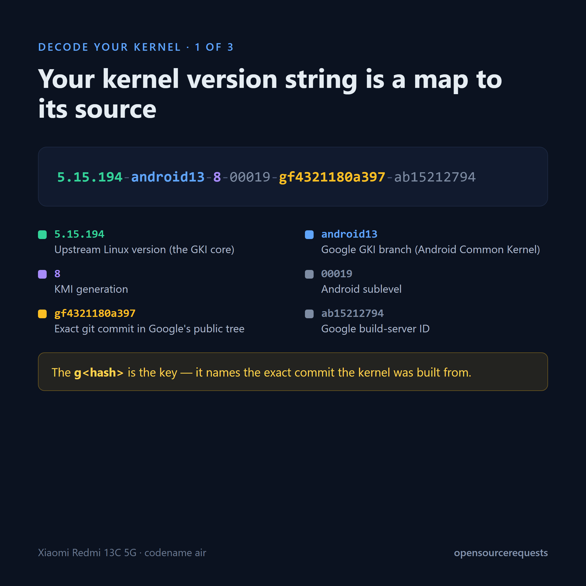
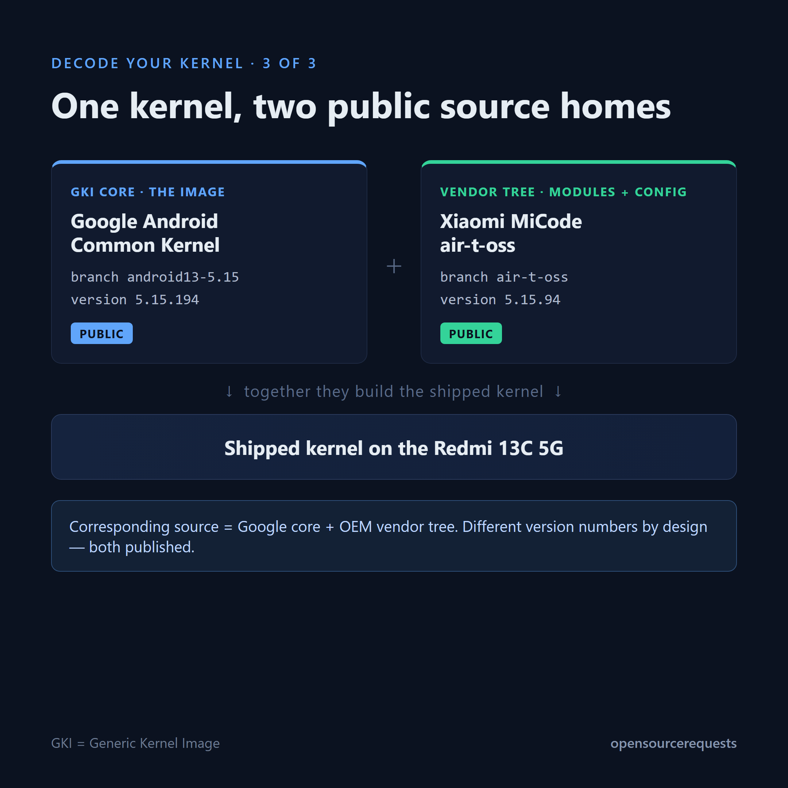

# Redmi 13C 5G (air) — finding the GPL corresponding source (a GKI worked example)

A good-faith, educational walkthrough of how to locate the complete GPL
corresponding source for the Linux kernel on a **Xiaomi Redmi 13C 5G** — a
**GKI (Generic Kernel Image)** Android device.

**Takeaway:** the source is available and precisely identifiable. On a GKI device
the kernel has two source homes — the GKI **core** (published by Google) and the
**vendor tree** (published by the OEM) — and the device's own kernel version
string names the exact Google commit the core was built from.

## Device

| Field | Value |
|---|---|
| Model | 23124RN87I (Redmi 13C 5G) |
| Codename | `air` (MediaTek Dimensity 6100+) |
| OS build | OS2.0.208.0.VGQINXM (Android 15 / HyperOS 2.0) |
| Kernel (shipped) | `5.15.194-android13-8-00019-gf4321180a397-ab15212794` |
| Security patch | 2026-08-01 |

## 1. Read the kernel version string

`5.15.194` upstream Linux version &middot; `android13` Google GKI branch &middot;
`8` KMI generation &middot; `00019` Android sublevel &middot; `gf4321180a397` the
exact git commit in Google's public tree &middot; `ab15212794` Google
build-server ID.

## 2. One kernel, two public source homes (GKI)

- **GKI core** (the `Image`) — Google's Android Common Kernel, branch
  `android13-5.15`, version **5.15.194**. Public.
- **Vendor tree** (modules, defconfig, device trees) — Xiaomi MiCode
  `air-t-oss`, version **5.15.94**. Public.

The two carry different version numbers by design; the vendor tree stays
KMI-compatible with the GKI core it ships against. Complete corresponding
source = GKI core (Google) + vendor tree (OEM).

## 3. Find the exact GKI core source

The `g…` field in the kernel string is a git commit, and it maps straight to a
public Google tag:

- Device commit: `f4321180a397`
- AOSP tag: **`android13-5.15-2025-12_r9`** → commit `f4321180a3973d19…`, whose
  `Makefile` reads `VERSION = 5`, `PATCHLEVEL = 15`, `SUBLEVEL = 194` =
  **Linux 5.15.194**.

Source: `android.googlesource.com/kernel/common` (tag `android13-5.15-2025-12_r9`).
Verify: `/+/refs/tags/android13-5.15-2025-12_r9/Makefile`.

So the shipped GKI core's source is public, and the device points to the exact
commit.

## 4. The vendor tree

- Repo: `github.com/MiCode/Xiaomi_Kernel_OpenSource`, branch `air-t-oss`
  (commit `13290e766`), `Makefile` → 5.15.94.
- MTK GPL modules: `github.com/MiCode/MTK_kernel_modules`, branch `air-t-oss`.
- Build/install scripts present: `build.config.mtk.aarch64`, Kbuild/Kconfig,
  GKI defconfigs (GPLv2 §3).

## Build verification

The published `air-t-oss` vendor source **compiles into a bootable ARM64
`Image`** (built with LTO/BTF off and the generic `gki_defconfig` to fit the
build host, so not byte-identical to the shipped kernel). This confirms the
published vendor source is genuine, complete, and buildable. Details in
[`audit/`](audit/) → *Build Verification*.

## License / obligation audit

See [`audit/`](audit/): 63 copyleft components mapped; AGPL and `lzma`
classifier flags resolved as false positives; attribution notes included.
Upstream copyright headers + SPDX tags are preserved in the kernel source
(GPLv2 §1).

## Conclusion

The complete corresponding source for this device is obtainable from public
trees:

- **GKI core 5.15.194** → Google ACK tag `android13-5.15-2025-12_r9` (public,
  exact commit named by the device).
- **Vendor tree** → MiCode `air-t-oss` + MTK modules (public).

The `5.15.194` vs `5.15.94` difference reflects the **GKI core / vendor split**,
not a missing-source gap.

## Reproduce this yourself

1. `adb shell uname -r` — read the kernel string.
2. Take the `g<hash>` field and find the matching commit in Google's ACK:
   `git ls-remote https://android.googlesource.com/kernel/common | grep <hash>`
   (or scan the `android13-5.15-*` tags).
3. Read that tag's `Makefile` to confirm the version.
4. For the vendor tree, find the OEM's kernel repo (here, MiCode `air-t-oss`)
   for modules, defconfig and device trees.

## Evidence

See [`evidence/`](evidence/) — the on-device kernel string, the MiCode vendor
`Makefile`, and the on-device open-source page, in clean and marked pairs.

## Note

A good-faith, educational exercise — **not legal advice**. On GPL/GKI devices,
corresponding source spans the Google-published core and the OEM-published
vendor tree.
