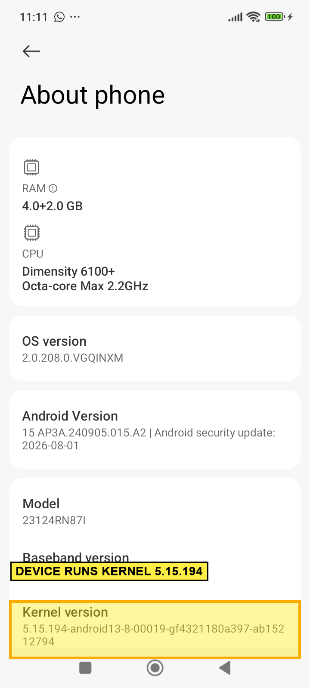
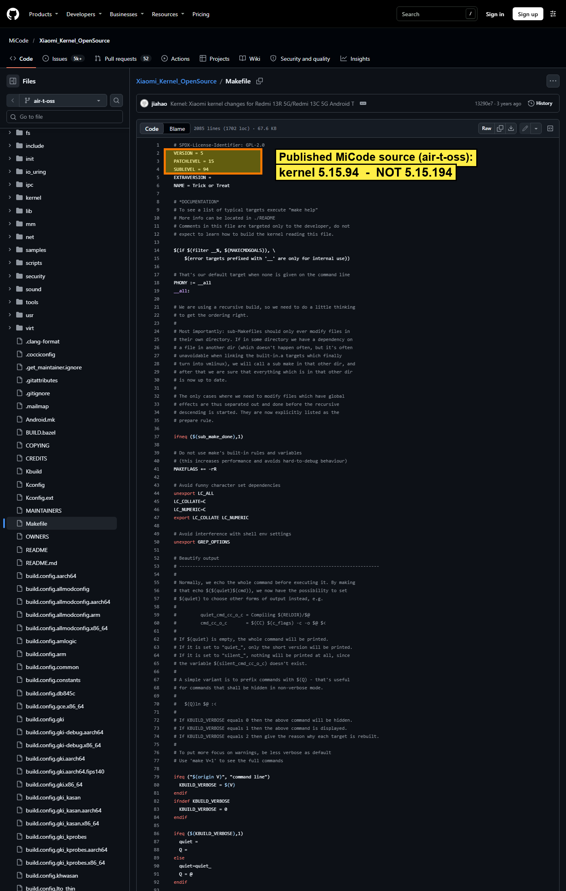
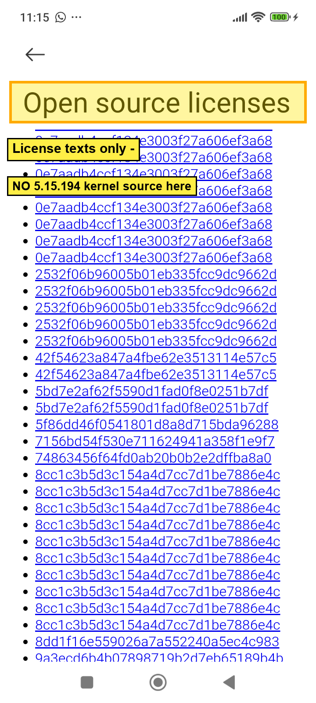

# Evidence

Each item has a **clean** original and a **_MARKED** version (yellow highlights).
Both are included so the highlights can be checked against the unaltered source.

## 1. Device runs kernel 5.15.194

Settings → About phone, on the device. Full string:
`5.15.194-android13-8-00019-gf4321180a397-ab15212794`.

Clean original: [`1_device_kernel_5.15.194.png`](1_device_kernel_5.15.194.png)

## 2. Xiaomi's published vendor tree is kernel 5.15.94

`github.com/MiCode/Xiaomi_Kernel_OpenSource`, branch `air-t-oss`, `Makefile`
(`VERSION = 5`, `PATCHLEVEL = 15`, `SUBLEVEL = 94`). This is the **vendor tree**
(modules, defconfig, device trees) — a different component from the GKI core,
and it need not share the core's sublevel.

Clean original: [`2_micode_published_source_5.15.94.png`](2_micode_published_source_5.15.94.png)

## 3. Device open-source page offers license texts only

Settings → Open source licenses, on the device — license texts (by content
hash), no kernel-source download. (Source is obtained from the public repos
above, not from this page.)

Clean original: [`3_device_opensource_page.png`](3_device_opensource_page.png)

---

**Summary:** the device ships GKI kernel **5.15.194** (its source is Google's
public ACK tag `android13-5.15-2025-12_r9`, commit `f4321180a397`), and Xiaomi
publishes the matching **vendor tree** (5.15.94) on MiCode. Both halves of the
corresponding source are public.
